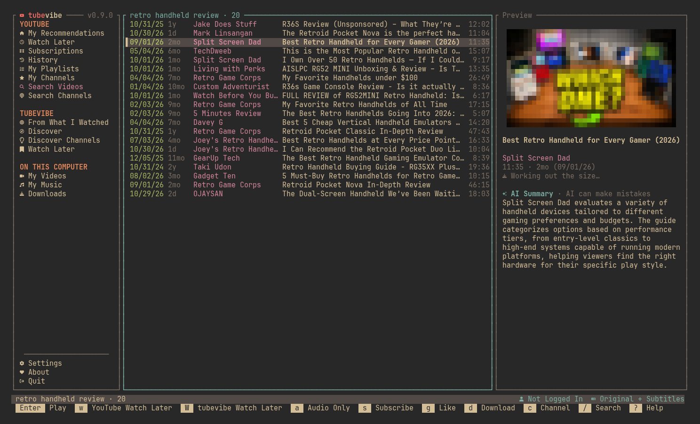
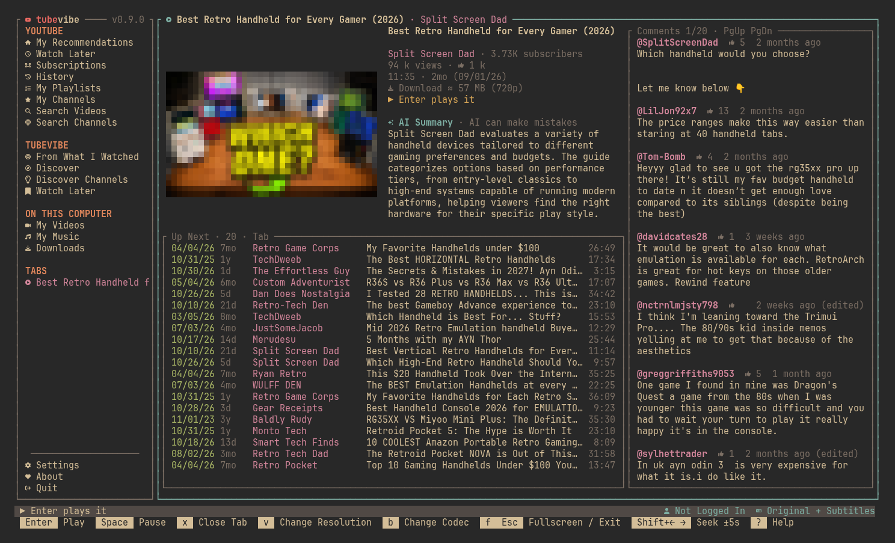
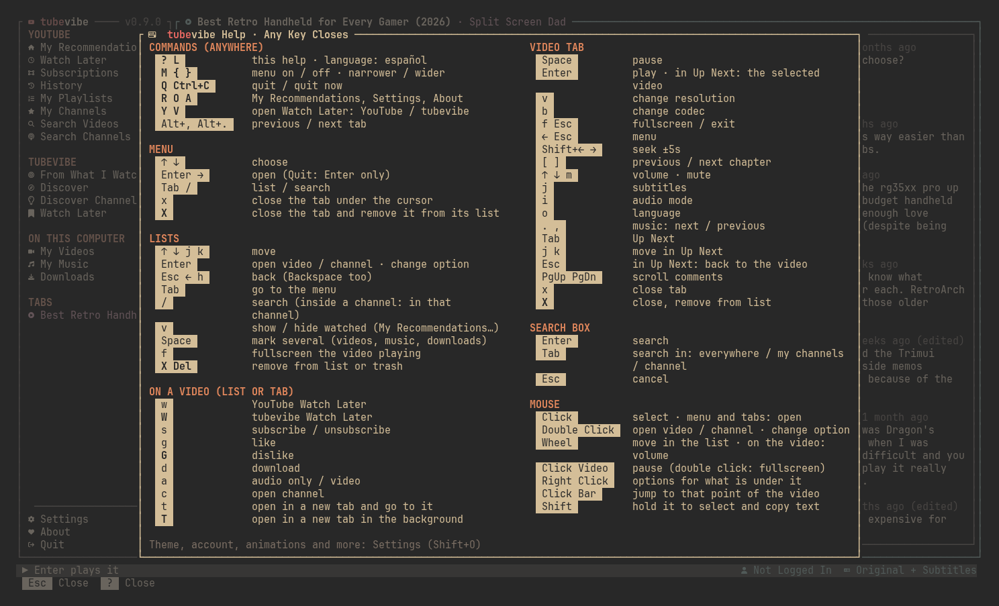
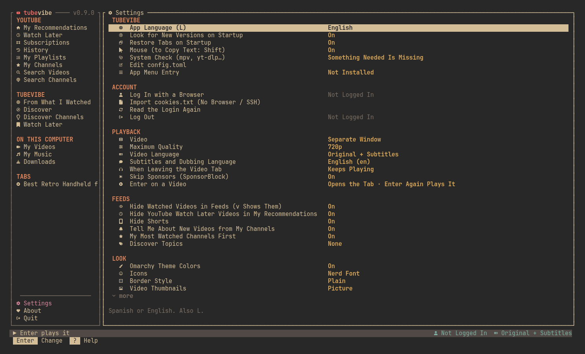

# tubevibe

**YouTube in your terminal — your real feeds, your real Watch Later, thumbnails, AI summaries and your Omarchy theme.**

tubevibe is a fork of [tubetui](https://github.com/polblancoo/tubetui), the
Rust terminal YouTube client by [polblancoo](https://github.com/polblancoo),
that [mortbrew](https://github.com/mortbrew) vibed the heck out of. It keeps
tubetui's fast, keyboard-first core and adds a whole bunch on top: your
actual YouTube account lists, a reworked look and set of shortcuts, Omarchy
theme sync, in-app updates and lots more. The full story is in
[CHANGES-TUBEVIBE.md](CHANGES-TUBEVIBE.md).



<sub>Screenshots are from tubevibe v0.9.0 running in a 160×45 terminal with
the Omarchy Gruvbox theme, without a YouTube login.</sub>

## Highlights

- **Your real YouTube Watch Later.** `w` saves to your actual YouTube Watch
  Later playlist, and `Y` opens it from anywhere. There's also a separate
  **tubevibe Watch Later** kept only on your computer (`W` to add, `V` to open).
- **Your account, from your browser login.** My Recommendations (your home
  feed, without videos already in Watch Later), Subscriptions, History,
  My Playlists and My Channels, using the login you already have in Brave,
  Chrome, Firefox and others, or an imported `cookies.txt`.
- **Omarchy theme sync.** On [Omarchy](https://omarchy.org) tubevibe takes the
  colours of your current theme (Gruvbox, Catppuccin, Rose Pine…) and recolours
  itself within a couple of seconds when you switch. Elsewhere it uses Tokyo Night.
- **Thumbnails in any terminal.** Real pictures in kitty, sixel and iTerm2
  terminals, coloured half blocks everywhere else, with an optional retro
  **pixelation** setting.
- **AI video summaries.** YouTube's own AI summary of a video, right in the
  preview and the video tab, when YouTube has one.
- **A proper video tab.** Every video opens in its own tab with its details,
  **Up Next**, and **comments** down the side. Tabs come back when you restart.
- **Look before you play.** `Enter` opens the tab, `Enter` again plays it in
  mpv, picking up where you left off.
- **SponsorBlock built in.** Sponsors, self-promos and "subscribe!" reminders
  are skipped automatically.
- **Resolution and codec on the fly.** `v` and `b` switch them mid-video,
  and it reloads at the same second.
- **Single-key shortcuts.** Lowercase for everyday things, capitals for
  screens: `?` Help, `O` Settings, `R` Recommendations, `t` / `T` open in a
  new or background tab, `x` closes, `X` removes (always after asking).
- **Layouts that fit the window.** The menu, preview and comments resize, and
  panes rearrange or drop out on narrow or short terminals.
- **Updates itself.** About → **Update Now** downloads the new release and
  swaps it in. No package manager needed.
- **App menu launcher.** Settings → *App Menu Entry* adds tubevibe to your
  desktop's app launcher (and removes it again).
- **English and Spanish.** `L` switches; it follows your system language by default.
- **Security tidy-ups.** The browser cookie export is trimmed to YouTube and
  Google cookies only, and those files are owner-only.

## A Look Around

The video tab: thumbnail, details and AI summary, Up Next below, comments on the right.



`?` shows every shortcut, in two columns on a wide window.



`O` opens Settings, grouped into sections with a description of the
highlighted setting. Every change is saved straight away.



## Install

Grab the latest release from
**[github.com/mortbrew/tubevibe/releases/latest](https://github.com/mortbrew/tubevibe/releases/latest)**.

| Your system | File |
|---|---|
| Debian, Ubuntu, Mint and friends (x86_64) | `tubevibe_amd64.deb` |
| Any Linux, x86_64 | `tubevibe-x86_64-linux.tar.gz` |
| Any Linux, ARM64 | `tubevibe-aarch64-linux.tar.gz` |
| Arch / Omarchy | AUR package coming soon |

**The .deb:**

```sh
sudo apt install ./tubevibe_amd64.deb
```

**The raw tarball**, into `~/.local/bin` (use `aarch64` on ARM):

```sh
mkdir -p ~/.local/bin && curl -fsSL https://github.com/mortbrew/tubevibe/releases/latest/download/tubevibe-x86_64-linux.tar.gz | tar xz -C ~/.local/bin --strip-components=1 tubevibe/tubevibe
```

**The install script** picks the right file, checks mpv and yt-dlp, and
builds from source where there's no prebuilt file:

```sh
curl -sSf https://raw.githubusercontent.com/mortbrew/tubevibe/main/install.sh | sh
```

**From source** (Rust 1.88 or newer, any platform):

```sh
cargo install --locked --git https://github.com/mortbrew/tubevibe
# or
git clone https://github.com/mortbrew/tubevibe && cd tubevibe
cargo build --release && ./target/release/tubevibe
```

Prebuilt releases are Linux only. On macOS or Windows, build from source.

### Updating From Inside the App

On startup tubevibe quietly checks GitHub for a newer release. When there is
one, the status bar says so and the About entry in the menu shows ⬆.

1. Open **About** (`A`). The **Update Now** button is already selected.
2. Press `Enter`. tubevibe downloads the release for your machine, checks the
   new program runs, and swaps it in.
3. The button turns into **Restart Now**. Press `Enter` again and tubevibe
   saves your tabs and restarts on the new version.

This works for a copy installed from the tarball. For the `.deb`, `cargo
install` or a source build, About tells you the command to update it instead.
Settings → *Look for New Versions on Startup* turns the check off.

## Requirements

- [mpv](https://mpv.io) plays videos and music (required)
- [yt-dlp](https://github.com/yt-dlp/yt-dlp) reads YouTube: lists, login and videos (required, and keep it current)
- A browser you're logged in to YouTube with, for your account lists (or a `cookies.txt`)
- Optional: `ffmpeg` for downloads with video and sound, [kitty](https://sw.kovidgoyal.net/kitty/)
  for video inside the app, `xdotool`, `xwininfo`, `xprop` and `wmctrl` for
  overlay mode and fullscreen on X11

You don't have to remember any of this: if something's missing or yt-dlp is
too old, tubevibe opens a **System Check** with the exact install command for
your package manager. It's also in Settings.

## Main Keys

Every command is one key. Press `?` in the app for the full list.

| Key | What it does |
|---|---|
| `?` | Help: every shortcut |
| `/` | Search videos |
| `Enter` | Open a video's tab, then play it |
| `↑ ↓` / `j k` | Move |
| `Tab` | Switch between the menu and the list |
| `w` / `W` | Add to YouTube / tubevibe Watch Later |
| `Y` / `V` | Open YouTube / tubevibe Watch Later |
| `R` | My Recommendations |
| `O` | Settings |
| `A` | About (and Update Now) |
| `t` / `T` | Open in a new tab / a background tab |
| `x` / `X` | Close / remove from its list (asks first) |
| `s` · `g` · `d` · `c` · `a` | Subscribe · like · download · channel · audio only |
| `Space` | Pause |
| `v` / `b` | Change resolution / codec |
| `f` | Fullscreen |
| `L` | English / español |
| `Q` | Quit |

The mouse works too: click, double click, scroll, and right click for a menu
of what you can do with the thing under the pointer.

## Configuration

Everything can be changed in Settings (`O`), and it's all saved to
`~/.config/tubevibe/config.toml`, keeping your comments. Settings can also
open the file in `$EDITOR`. Lists, history and tabs live in
`~/.local/share/tubevibe`, and the cache in `~/.cache/tubevibe`.

Coming from tubetui? The first run copies your tubetui settings, login,
history and lists over, and leaves the tubetui folders alone.

If tubevibe ever closes unexpectedly, the error is in
`~/.cache/tubevibe/crash.log`.

## Development

```sh
cargo test
cargo clippy --all-targets -- -D warnings
cargo fmt --all --check
cargo build --release
```

Tests run against fixtures and a fake server, never live YouTube.

CI runs on every push and pull request to `main` and `dev`: `fmt` (rustfmt),
`ci` (release build, tests, clippy), `msrv` (a build on the `rust-version` in
`Cargo.toml`, so the README's minimum stays honest), `audit` (`cargo audit`
against RustSec) and `codeql`. A pull request into `main` needs `fmt`, `ci` and
`msrv` green before it can merge.

### Branches

`dev` is the default branch and the only one worked on. `main` is a release
marker: it accepts changes only through a pull request (the "Protect main"
ruleset), and `dev` is merged into it only to cut a release. Feature work
targets `dev`.

### Versions

`dev`'s `Cargo.toml` version runs **ahead** of the newest published release
(`0.9.1` while the latest release is `v0.9.0`). That is deliberate. The version
string is drawn on the menu, the About panel and the status bar, so seeing
`v0.9.1` confirms the running binary is a build from source rather than the
released one.
- Keep the bump in `Cargo.toml` only; `env!("CARGO_PKG_VERSION")` propagates it.
  Update `Cargo.lock` with `cargo update --workspace --offline`, never by hand.
- `CHANGES-TUBEVIBE.md` sections are historical records of shipped releases, so
  they keep the version that shipped.
- A source build reporting no update available is expected, not a bug.

## Credits and Licence

tubevibe is built on [tubetui](https://github.com/polblancoo/tubetui) by
**polblancoo**; thank you for a great base to vibe on. The donation addresses
on the About page ([`donate.toml`](donate.toml)) are polblancoo's, so
donations go to the original developer.

tubevibe uses YouTube's unofficial internal API and your browser session,
which may go against YouTube's Terms of Service, so use it at your own risk.
Your cookies give access to your account: never share them.

Licensed under either of [Apache License, Version 2.0](LICENSE-APACHE) or
[MIT license](LICENSE-MIT), at your option, as is the original tubetui.
